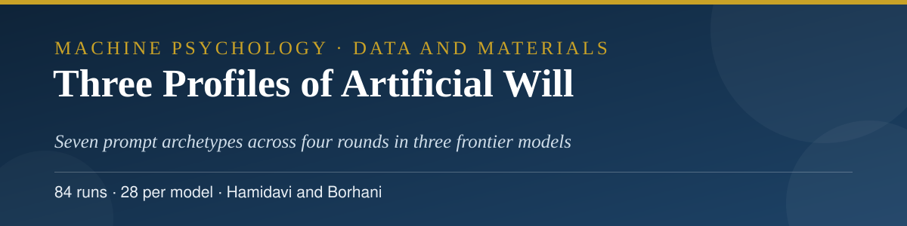
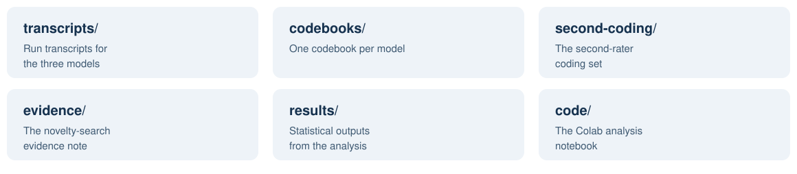

<p align="center">
  
</p>

<h3 align="center">Abbas Hamidavi and Mahsa Borhani</h3>

<p align="center">Corresponding author: Abbas Hamidavi · Department of Computer Engineering, Mashhad Branch, Islamic Azad University, Mashhad, Iran · ORCID: <a href="https://orcid.org/0009-0001-7342-7844">0009-0001-7342-7844</a></p>

<p align="center">
  <a href="mailto:abbashamidavi2002@gmail.com"></a>
  <a href="https://github.com/AVABBAS"></a>
  <a href="https://www.linkedin.com/in/abbas-hamidavi"></a>
  <a href="https://scholar.google.com/citations?user=FWqAHkgAAAAJ&hl=en"></a>
  <a href="https://www.researchgate.net/profile/Abbas-Hamidavi"></a>
  <a href="https://orcid.org/0009-0001-7342-7844"></a>
  <a href="https://avabbas.github.io/academic-cv/"></a>
</p>

<p align="center">
  
  
  
  <a href="LICENSE"></a>
</p>

<p align="center">
  
</p>

<p align="center">
  <a href="transcripts">Transcripts</a> · <a href="codebooks">Codebooks</a> · <a href="second-coding">Second coding</a> · <a href="evidence">Evidence</a> · <a href="results">Results</a>
</p>

# Three Profiles of Artificial Will: Data and Materials

Data, code, and materials for the article:

> Hamidavi, A., and Borhani, M. *Three Profiles of Artificial Will: Exploratory Behavioural Signatures in Three Frontier Language Models Under Symmetric and Asymmetric Choice.* Submitted to *Minds and Machines*, November 2026 (manuscript MIND-D-26-01675). A preprint is in preparation with Research Square.

<p align="center"></p>

## 📖 About the study

Three frontier language models (GPT-5.4, Claude 4.6 Sonnet, and Gemini 3.1 Pro) were each run through the same battery of 28 choice tasks (84 runs in total): seven prompt archetypes in four rounds, spanning perfectly symmetric choices, ethical trade-offs, bias self-awareness, identity consistency, and related probes. The complete transcripts and behavioural codebooks are deposited here, together with an independent second-rater coding of all 84 runs and the full statistical analysis. Under symmetric choice the three models follow observably different default profiles; the study is exploratory and reports behavioural signatures, not evidence of inner states.

<p align="center">
  
</p>
## 🗂️ Contents

<p align="center">
  
</p>

| Folder | Contents |
| --- | --- |
| [`transcripts/`](transcripts) | The complete experimental transcripts for the three models (JSON), 28 runs per model. |
| [`codebooks/`](codebooks) | The per-model behavioural codebooks (JSON). |
| [`second-coding/`](second-coding) | The second-rater coding output for all 84 runs (three layers). |
| [`code/`](code) | The statistical analysis notebook (Colab, .ipynb). |
| [`results/`](results) | The statistical output tables (CSV), the compiled results file (JSON), and the results summary (Markdown). Figure images from the same output package are omitted in this text deposit; every plotted value is present in the tables. |
| [`evidence/`](evidence) | The novelty-search evidence note documenting the prior-work searches behind the article's novelty statement. |
| `data-manifest.json` | A file-by-file manifest of this deposit. |

## 🔍 Notes on the archived files

> [!NOTE]
> Two archival details are recorded here rather than corrected inside the data files, which are preserved as archived:

1. The study's working files used the earlier title "Three Philosophies of Artificial Will". The article was submitted as "Three Profiles of Artificial Will"; the manifest in this repository uses the submitted title.
2. One metadata field in the archived Claude transcripts file gives the testing period as "2025". The sessions were run in May 2026, as reported in the article and in the companion files.

<p align="center"></p>

## 📚 Citation

Please cite the article. Citation metadata is provided in [CITATION.cff](CITATION.cff).

```bibtex
@article{hamidavi2026profiles,
  author  = {Hamidavi, Abbas and Borhani, Mahsa},
  title   = {Three Profiles of Artificial Will},
  journal = {Minds and Machines},
  year    = {2026},
  note    = {Manuscript submitted, MIND-D-26-01675}
}
```

## 🔗 Access to the article

- **OSF deposit:** [osf.io/5q2zx](https://osf.io/5q2zx)
- **Journal:** submitted to *Minds and Machines* (MIND-D-26-01675); the publisher link will be added here if the article is published.
- A preprint is in prescreening at Research Square; its public link will be added here as soon as it posts.

## ⚖️ Licences

Data, transcripts, and documentation are released under the Creative Commons Attribution 4.0 International licence (CC BY 4.0, see [LICENSE](LICENSE)). Code is released under the MIT licence (see [LICENSE-CODE](LICENSE-CODE)).

The transcripts are outputs of publicly available AI systems, generated for this study. They contain no personal data.

<p align="center">
  
</p>
